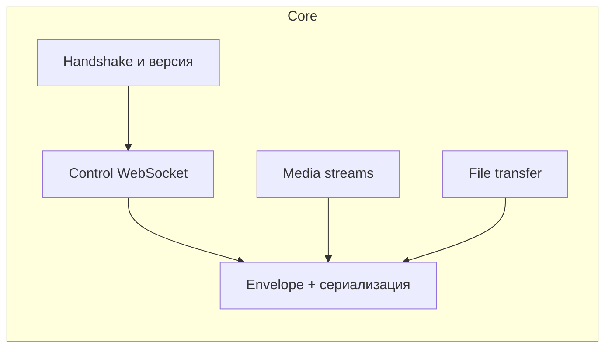

# План 02 — Протокол и сетевой слой (core)

## Цель

Спроектировать и реализовать в модуле `core` транспорт и протокол обмена между клиентом (Windows) и сервером (Android), включая TLS-канал и мультиплексирование потоков.

## Зависимости

[`plans/01-project-skeleton.md`](01-project-skeleton.md)

## Архитектура

- Android выступает **сервером** (слушает порт), Windows — **клиентом** (подключается).
- Возможен обратный режим (Windows как сервер) для некоторых сценариев — закладываем симметрию.

## Слои

1. **Transport:** TLS/TCP (Ktor). Самоподписанные сертификаты, доверие после сопряжения.
2. **Envelope:** общий формат сообщения: `id`, `type`, `channel`, `replyTo`, `payload`, `timestamp`.
3. **Channels:**
   - `control` — WebSocket, запрос/ответ и события (RPC).
   - `screen` — бинарный поток кадров экрана.
   - `camera` — бинарный поток камеры.
   - `audio` — поток звука/микрофона.
   - `files` — чанкованные передачи файлов.
4. **Handshake:** обмен `protocolVersion`, `deviceId`, `capabilities`, `sessionToken`.

## Типы сообщений control (черновик)

- `hello`, `helloAck`, `ping`, `pong`
- `pairRequest`, `pairConfirm`, `pairReject`
- `screenStart`, `screenStop`, `screenFrame` (метаданные)
- `inputTap`, `inputSwipe`, `inputText`, `inputKey`, `inputMultiTouch`
- `fsList`, `fsStat`, `fsDownload`, `fsUpload`, `fsDelete`, `fsRename`, `fsMkdir`
- `syncPlan`, `syncApply`, `syncStatus`, `syncConflict`
- `clipboardSet`, `clipboardGet`, `clipboardEvent`
- `notificationPost`, `notificationRemove`
- `smsList`, `smsSend`, `callState`, `callAction`
- `capabilityRequest`, `capabilityGrant`

## Шаги реализации

1. Определить data-классы `Envelope` и всех сообщений (kotlinx.serialization) с полем версии.
2. Реализовать `ProtocolCodec` (encode/decode, проверка версии).
3. Реализовать `TlsManager`: генерация self-signed сертификата, хранилище доверенных.
4. Реализовать `ControlChannel` (WebSocket RPC): маршрутизация запросов/ответов по `id`, таймауты.
5. Реализовать `MediaChannel` и `FileChannel` (бинарные фреймы с заголовком: streamId, seq, size).
6. Реализовать `ServerConnection` (Android) и `ClientConnection` (Windows) поверх общего интерфейса.
7. Реализовать переподключение, heartbeat (`ping/pong`), обработку обрывов.
8. Реализовать бэкпрешер и буферизацию для медиа-потоков.

## Краевые случаи

- Обрыв сети и reconnect с восстановлением подписок.
- Несовместимые версии протокола — вежливый отказ с предложением обновиться.
- Большие сообщения — лимит и разбиение.
- Защита от медленных/вредоносных пиров (таймауты, лимиты).

## Критерии готовности

- [ ] Стабильное TLS-соединение между Windows и Android.
- [ ] Работает RPC-обмен control-сообщениями.
- [ ] Есть механизм heartbeat и автопереподключения.
- [ ] Юнит-тесты кодека и маршрутизации.
