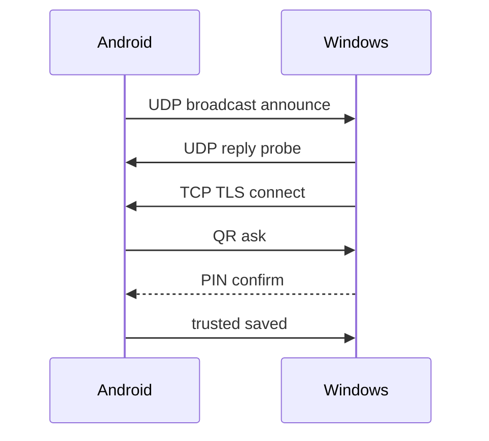

# План 03 — Обнаружение устройств и сопряжение

## Цель

Реализовать авто-обнаружение устройств в локальной сети и безопасное сопряжение по QR-коду с PIN.

## Зависимости

[`plans/01-project-skeleton.md`](01-project-skeleton.md), [`plans/02-protocol-and-network.md`](02-protocol-and-network.md)

## Архитектура

## Обнаружение

- **UDP broadcast** на порт `47812` (или настраиваемый): периодический announce с `deviceId`, именем, портом TLS, типом.
- **mDNS** сервис `_efir._tcp.local` как альтернативный/дополнительный механизм (библиотеки: JmDNS на JVM, NSD на Android).
- Список обнаруженных устройств с обновлением по TTL (удаление «протухших»).
- Ручное подключение по `IP:порт` как резерв.

## Сопряжение

- Android-приложение генерирует **QR-код** с: `deviceId`, отпечаток сертификата, одноразовый `pairingToken`, `expiresAt`.
- Windows сканирует QR (камера) или Android сканирует QR с экрана ПК — поддержать оба направления.
- После сканирования — подтверждение **PIN/кода** на обеих сторонах (защита от подмены).
- Успех: обмен публичными отпечатками, сохранение доверенного устройства в защищённом хранилище (Android Keystore / Windows DPAPI).
- Повторные подключения — без QR (по сохранённому доверию).

## Данные хранилища (SQLDelight)

- Таблица `trusted_devices`: id, name, certFingerprint, lastSeen, permissions.
- Таблица `pairing_sessions` (временные токены).

## Шаги реализации

1. Реализовать UDP announcer/listener в `core` (`expect/actual` для сокетов).
2. Реализовать mDNS-регистрацию/дискавери (Android NsdManager, JVM JmDNS).
3. UI: экран «Устройства рядом» на обеих сторонах с обновлением в реальном времени.
4. Реализовать генерацию и рендер QR (Android ZXing; Desktop ZXing + скан через камеру).
5. Реализовать протокол сопряжения (`pairRequest`/`pairConfirm`) поверх TLS.
6. Реализовать безопасное хранилище сертификатов/токенов.
7. Реализовать управление доверенными устройствами (список, отзыв, переименование).

## Краевые случаи

- Несколько сетевых интерфейсов (Wi-Fi + Ethernet) — вещать на все.
- Гостевая Wi-Fi сеть с изоляцией клиентов — предупреждать пользователя.
- Истёкший QR/токен — перегенерировать.
- Попытка подключения незнакомого устройства — запрос подтверждения.

## Критерии готовности

- [x] Устройства находят друг друга автоматически за несколько секунд.
      — Реализовано: UDP-бродкаст (`UdpDiscoveryTransport` + `DiscoveryManager`, TTL-очистка)
      и UI-индикатор «протухания» (время с последнего анонса + предупреждение о недоступности).
      — Осталось: mDNS-дублирование (JmDNS/NSD).
- [x] Сопряжение по QR+PIN работает и сохраняется (сетевое сопряжение поверх WebSocket).
      — QR-код рендерится как изображение (ZXing + Compose Canvas).
- [x] Повторное подключение без QR (handshake `Hello` с `sessionToken` доверия).
- [x] Есть список доверенных устройств с отзывом (секция Trusted devices в UI).
- [x] Доверие сохраняется на диск и переживает перезапуск приложения (`FileTrustStore`).

## Что реализовано (итерация 2)

- Персистентное хранилище доверия [`FileTrustStore`](core/src/jvmCommon/kotlin/ru/efir/core/pairing/FileTrustStore.kt)
  (JSON-файл, атомарная запись через временный файл). Подключено в `Main.kt` (Desktop, `~/.efir`)
  и `MainActivity.kt` (Android, `filesDir`).
- Генерация QR-кода: общий контракт [`QrCode`](core/src/commonMain/kotlin/ru/efir/core/pairing/QrCode.kt)
  (`expect`), JVM-реализация на ZXing [`QrCode.jvm.kt`](core/src/jvmCommon/kotlin/ru/efir/core/pairing/QrCode.jvm.kt).
- Отрисовка QR [`QrCodeView`](core/src/commonMain/kotlin/ru/efir/core/pairing/QrCodeView.kt)
  на Compose Canvas, встроена в панель сопряжения хоста.
- Тесты: `FileTrustStoreTest` (персистентность, отзыв, перезапись) и
  `QrCodeTest` (размер матрицы, round-trip payload через ZXing, отказ для слишком длинных строк).

## Что реализовано (итерация 1)

- Сетевые фабрики `createEfirHost` / `openEfirConnection` (`expect/actual`, JVM-реализация поверх Ktor).
- [`HostHandshake`](core/src/commonMain/kotlin/ru/efir/core/app/SessionHandshake.kt) — обработка `Hello`,
  `PairRequest`, `RequestCapabilities` на хосте; делегирование в `PairingService`/`TrustStore`.
- `ClientHandshake` — приветствие и сопряжение по QR+PIN с клиента.
- [`EfirController`](core/src/commonMain/kotlin/ru/efir/core/app/EfirController.kt) — подъём сервера,
  подключение к устройству, состояния `connection`/`connectionError`/`trustedDevices`, отзыв доверия.
- UI: панель хоста (PIN + данные QR), панель клиента (вставка QR + PIN, ручной IP),
  карточка статуса соединения, список доверенных устройств.
- Интеграционные тесты сопряжения по сети (`PairingNetworkTest`).

## Что реализовано (итерация 3)

- **UI-индикатор «протухания» найденных устройств**: [`DeviceCard`](core/src/commonMain/kotlin/ru/efir/core/app/EfirAppScreen.kt)
  показывает время с последнего анонса (`ageLabel`), а при превышении порога
  (`DEVICE_STALE_MS`, 6 с) — предупреждение о возможной недоступности.

## Что осталось по блоку 03

- Сканирование QR камерой (Android ZXing embedded / Desktop webcam) — сейчас ручной ввод/вставка.
- mDNS-регистрация/обнаружение как альтернатива UDP.
- Шифрование содержимого хранилища доверия (Android Keystore / Windows DPAPI);
  сейчас файл защищён только правами файловой системы.
- TLS-обёртка сервера (сейчас соединение в режиме без шифрования для отладки).
- Предупреждение об изоляции клиентов в гостевой Wi-Fi сети.
