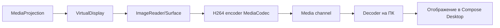

# План 04 — Захват экрана Android и трансляция на ПК

## Цель

Захватывать экран Android через `MediaProjection` и передавать поток на Windows с настройкой качества и низкой задержкой.

## Зависимости

[`plans/02-protocol-and-network.md`](02-protocol-and-network.md)

## Архитектура

## Компоненты (Android)

- **MediaProjectionManager**: запрос разрешения (Activity result), создание `MediaProjection`.
- **VirtualDisplay** + **Surface** от `MediaCodec` (без промежуточного ImageReader для производительности).
- **MediaCodec** H.264 hardware encoder, ключевые кадры по запросу, пауза/возобновление.
- Учёт `onCapturedContentResize` (Android 14+) для смены разрешения/ориентации.
- Foreground Service с типом `mediaProjection` для стабильной работы в фоне.

## Компоненты (Windows)

- Приём NAL-юнитов, декодирование (JCodec / MediaFoundation / ffmpeg-jni).
- Отображение в Compose Desktop (Skia `ImageBitmap`), масштаб/вписать.
- Буферизация и синхронизация кадров, отбрасывание «просроченных» для низкой задержки.

## Настройки потока

- Разрешение (например, 720p/1080p/нативно), битрейт, FPS (15/30/60).
- Кодек (H.264 по умолчанию, опционально AV1/VP9 при поддержке).
- Режим «производительность/качество».

## Шаги реализации

1. Запросить разрешение MediaProjection и запустить Foreground Service.
2. Создать VirtualDisplay + MediaCodec, проверить аппаратное кодирование.
3. Реализовать упаковку NAL-юнитов в фреймы медиа-канала (seq/timestamp/keyframe).
4. Реализовать декодер и рендер на Windows.
5. Добавить UI настроек качества на ПК.
6. Обработать смену ориентации/разрешения на лету.
7. Реализовать паузу/возобновление и остановку захвата.

## Краевые случаи

- Защищённый контент (DRM) — чёрный экран (честно информировать пользователя).
- Отзыв разрешения / остановка пользователем — корректно завершить поток.
- Слабый Wi-Fi — адаптивный битрейт, понижение качества.
- Энергопотребление и нагрев — ограничение FPS при перегреве.

## Критерии готовности

- [x] Видео экрана Android отображается на ПК (JPEG-кадры; H.264 — следующая итерация).
- [x] Задержка приемлемая для интерактивного управления (пропуск «просроченных» кадров).
- [~] Смена ориентации/разрешения — есть `updateConfig`, авто-реакция на `onCapturedContentResize` в плане.
- [x] Плавная остановка и повторный старт (`ScreenStart`/`ScreenStop`).

## Что реализовано (итерация 1)

- Бинарный формат медиа-кадра и кодек: [`MediaFrame`](core/src/commonMain/kotlin/ru/efir/core/media/MediaFrame.kt),
  [`MediaFrameCodec`](core/src/commonMain/kotlin/ru/efir/core/media/MediaFrameCodec.kt) (+ тесты).
- Контракт захвата и декодирования: [`ScreenCapture`](core/src/commonMain/kotlin/ru/efir/core/media/ScreenCapture.kt),
  [`ImageDecoding`](core/src/commonMain/kotlin/ru/efir/core/media/ImageDecoding.kt) (`expect`/`actual`).
- Передающая сторона: [`ScreenStreamHost`](core/src/commonMain/kotlin/ru/efir/core/media/ScreenStreamHost.kt) —
  обработчики `ScreenStart`/`ScreenStop`, кодирование кадров и отправка в SCREEN-канал.
- Принимающая сторона: [`ScreenStreamClient`](core/src/commonMain/kotlin/ru/efir/core/media/ScreenStreamClient.kt) —
  приём, декодирование в `ImageBitmap`, публикация последнего кадра и счётчиков.
- Android-захват: [`ScreenCapture.android.kt`](core/src/androidMain/kotlin/ru/efir/core/media/ScreenCapture.android.kt)
  (`MediaProjection` + `VirtualDisplay` + `ImageReader` → масштабирование → JPEG).
- Foreground-сервис: [`ScreenCaptureService`](androidApp/src/main/kotlin/ru/efir/android/ScreenCaptureService.kt),
  запрос разрешения MediaProjection в [`MainActivity`](androidApp/src/main/kotlin/ru/efir/android/MainActivity.kt).
- UI: панель передачи/отображения экрана в [`EfirAppScreen`](core/src/commonMain/kotlin/ru/efir/core/app/EfirAppScreen.kt).

## Что осталось по блоку 04

- Аппаратный H.264/AV1 (MediaCodec) вместо MJPEG-подобного JPEG-потока.
- Адаптивный битрейт/качество при слабом Wi-Fi.
- Автоматическая реакция на `onCapturedContentResize` (Android 14+) и поворот экрана в UI.
- Ограничение FPS при перегреве/энергосбережении.
