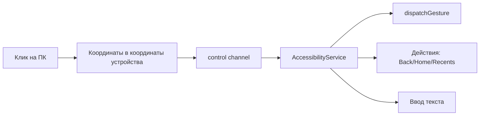

# План 05 — Инъекция ввода через AccessibilityService

## Цель

Реализовать удалённое управление Android без root: тапы, свайпы, мультитач, ввод текста и системные клавиши через `AccessibilityService`.

## Зависимости

[`plans/02-protocol-and-network.md`](02-protocol-and-network.md), [`plans/04-screen-capture-and-stream.md`](04-screen-capture-and-stream.md)

## Архитектура

## Возможности

- **Тап/долгое нажатие** — `GestureDescription.StrokeDescription`.
- **Свайп/перетаскивание** — траектория с интерполяцией.
- **Мультитач** (пинч-зум, два пальца) — несколько stroke-ов с `continueStroke`.
- **Ввод текста** — через `ACTION_SET_TEXT` в фокусированный узел или эмуляция клавиш.
- **Системные действия** — `GLOBAL_ACTION_BACK`, `HOME`, `RECENTS`, `NOTIFICATIONS`.
- **Поворот экрана**, включение/выключение экрана (где разрешено).

## Координатная модель

- ПК передаёт нормализованные координаты `(0..1)` либо координаты в пикселях потока.
- На Android — конвертация с учётом разрешения экрана, плотности и ориентации.
- Синхронизация: при `onCapturedContentResize` обновлять карту преобразования.

## Шаги реализации

1. Реализовать `AccessibilityService` с флагом `canPerformGestures`.
2. Определить формат сообщений `inputTap`, `inputSwipe`, `inputMultiTouch`, `inputText`, `inputKey`.
3. Реализовать `GestureInjector`: построение `GestureDescription`, отправка `dispatchGesture`.
4. Реализовать ввод текста и обработку IME (fallback: буфер обмена + вставка).
5. Реализовать привязку кликов/клавиатуры мыши на стороне ПК к сообщениям.
6. Обработать мультитач-жесты и жесты «несколько штрихов».
7. Обеспечить низкую задержку (батчинг, без лишних аллокаций).

## Краевые случаи

- Некоторые приложения/системные экраны игнорируют AccessibilityService (безопасность/игры).
- Ввод паролей в защищённые поля может блокироваться.
- Несовпадение координат при смене ориентации — пересчёт.
- Отключённая служба доступности — подсказать пользователю включить.

## Критерии готовности

- [x] Тап/свайп/долгое нажатие срабатывают точно (нормализованные координаты + map).
- [x] Мультитач-жесты поддерживаются (`InputMultiTouch` → несколько штрихов).
- [x] Ввод текста и системные клавиши работают (`ACTION_SET_TEXT`, `GLOBAL_ACTION_*`).
- [x] Координаты корректны при разных разрешениях (нормализация 0..1 + letterbox-маппинг).

## Что реализовано (итерация 1)

- Контракт инжектора и координатная модель: [`InputInjector`](core/src/commonMain/kotlin/ru/efir/core/input/InputInjector.kt)
  (`ScreenGeometry.mapX/mapY`, `NoOpInputInjector`, `expect`-фабрика).
- Хост-обработчики: [`InputInjectionHost`](core/src/commonMain/kotlin/ru/efir/core/input/InputInjectionHost.kt) —
  регистрирует `InputTap`/`InputSwipe`/`InputMultiTouch`/`InputText`/`InputKey`,
  масштабирует координаты и делегирует платформенному инжектору.
- Android-служба доступности: [`EfirAccessibilityService`](core/src/androidMain/kotlin/ru/efir/core/input/EfirAccessibilityService.kt)
  (`canPerformGestures`, `dispatchGesture`, `GLOBAL_ACTION_*`, `ACTION_SET_TEXT`).
- Android-инжектор: [`InputInjector.android.kt`](core/src/androidMain/kotlin/ru/efir/core/input/InputInjector.android.kt)
  (интерполяция свайпа, системные клавиши, удаление символа).
- Desktop: no-op инжектор ([`InputInjector.desktop.kt`](core/src/desktopMain/kotlin/ru/efir/core/input/InputInjector.desktop.kt)).
- Конфигурация службы и строки: `res/xml/efir_accessibility_service.xml`, `res/values/strings.xml`.
- Клиентские хелперы в [`EfirController`](core/src/commonMain/kotlin/ru/efir/core/app/EfirController.kt):
  `sendTap`, `sendSwipe`, `sendKey`, `sendText`; ввод в UI по клику на кадр экрана.
- Тесты: [`ScreenGeometryTest`](core/src/commonTest/kotlin/ru/efir/core/input/ScreenGeometryTest.kt).

## Что реализовано (итерация 2)

- Общая логика построения жестов: [`GestureBuilder`](core/src/commonMain/kotlin/ru/efir/core/input/GestureBuilder.kt)
  (линейная интерполяция свайпа, `pinch` двумя пальцами, `twoFinger`, `simplify`, `pathLength`).
- Точный маппинг координат с учётом letterbox: [`FrameMapping`](core/src/commonMain/kotlin/ru/efir/core/input/FrameMapping.kt)
  (`ContentScale.Fit`, `toNormalizedX/Y`, `contains`).
- Платформенные помощники службы доступности: [`AccessibilitySetup`](core/src/commonMain/kotlin/ru/efir/core/input/AccessibilitySetup.kt)
  (`expect`) + [`AccessibilitySetup.android.kt`](core/src/androidMain/kotlin/ru/efir/core/input/AccessibilitySetup.android.kt)
  (проверка `ENABLED_ACCESSIBILITY_SERVICES`/`AccessibilityManager`, открытие `ACTION_ACCESSIBILITY_SETTINGS`)
  и [`AccessibilitySetup.desktop.kt`](core/src/desktopMain/kotlin/ru/efir/core/input/AccessibilitySetup.desktop.kt).
- Клиент: [`EfirController.sendMultiTouch`](core/src/commonMain/kotlin/ru/efir/core/app/EfirController.kt),
  публикация ошибок инъекции (`inputError`), открытие настроек службы (`openInputServiceSettings`).
- UI: [`EfirAppScreen`](core/src/commonMain/kotlin/ru/efir/core/app/EfirAppScreen.kt) — распознавание
  одиночных и мультитач-жестов (`detectRemoteGestures`), пинч через `GestureBuilder.pinch`,
  диалог-подсказка [`AccessibilityPromptDialog`](core/src/commonMain/kotlin/ru/efir/core/app/EfirAppScreen.kt:141) при `input_not_ready`.
- Тесты: [`GestureBuilderTest`](core/src/commonTest/kotlin/ru/efir/core/input/GestureBuilderTest.kt)
  (интерполяция, пинч, прореживание, маппинг/letterbox).

## Что осталось по блоку 05

- Поворот экрана и включение/выключение (требуют спец. разрешений/root).
- Проверка координат при смене ориентации в реальном времени (использовать `onCapturedContentResize`).
