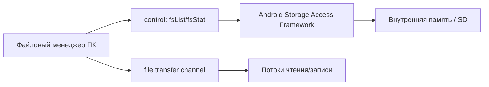

# План 06 — Двусторонний файловый менеджер

## Цель

Реализовать просмотр и управление файлами между Windows и Android (навигация, скачивание, загрузка, удаление, переименование, создание папок, предпросмотр).

## Зависимости

[`plans/02-protocol-and-network.md`](02-protocol-and-network.md), [`plans/03-discovery-and-pairing.md`](03-discovery-and-pairing.md)

## Архитектура

## Доступ к файлам (Android)

- **Storage Access Framework (SAF)** через `ACTION_OPEN_DOCUMENT_TREE` — пользователь выбирает корневые папки один раз.
- Persistable URI permissions для доступа между сессиями.
- Разделы: внутренняя память, SD-карта, специфичные папки (DCIM, Download, Documents).
- MediaStore для медиа (альбомы фото/видео) как альтернативный провайдер.

## Возможности UI

- Двухпанельный режим: слева ПК, справа телефон (или наоборот).
- Хлебные крошки, сортировка, поиск, фильтры по типу/дате/размеру.
- Операции: скачать, загрузить, переименовать, удалить, создать папку, копировать путь.
- Множественный выбор и очередь операций.
- Предпросмотр: изображения, видео (первый кадр/поток), тексты, метаданные.
- Прогресс передач со скоростью, остатком времени, паузой/отменой.

## Шаги реализации

1. Реализовать RPC `fsList`/`fsStat`/`fsDelete`/`fsRename`/`fsMkdir` в `core` + адаптер SAF на Android.
2. Реализовать экран файлового менеджера (Compose) с навигацией и операциями.
3. Реализовать предпросмотр (загрузка превью/стриминг).
4. Реализовать множественный выбор и очередь операций.
5. Реализовать безопасную работу с путями (запрет выхода за пределы разрешённых корней).
6. Добавить обработку ошибок доступа и подсказки по выдаче разрешений.

## Краевые случаи

- Отозванные разрешения SAF — запрос повторно.
- Специальные символы и длинные пути в именах файлов.
- Огромные папки — пагинация и ленивая загрузка.
- Изменение файла во время чтения — повторная попытка/проверка.

## Критерии готовности

- [x] Навигация и базовые операции над файлами (листинг/stat/удаление/переименование/mkdir).
- [x] Безопасная работа с путями (запрет выхода за доверенные корни, валидация имён).
- [x] Предпросмотр: загрузка блока файла (`fsReadBlock`, base64) + рендер — изображения (`decodeImage`), текст (фрагмент), метаданные для прочих типов.
- [~] Разрешения SAF: пока используется прямой доступ к внешнему хранилищу (нужны runtime-разрешения); SAF-адаптер — следующая итерация.
- [ ] Двухпанельный режим и постановка операций в очередь.

## Что реализовано (итерация 1)

- Модели ФС и контракт backend'а: [`FileModels`](core/src/commonMain/kotlin/ru/efir/core/files/FileModels.kt)
  (`FileListing`, `FileHandle`, `FileKind`/`classify`, интерфейс `FileSystem`).
- Безопасность путей: [`PathSanitizer`](core/src/commonMain/kotlin/ru/efir/core/files/PathSanitizer.kt)
  (нормализация, `isWithin`/`requireWithin`, `child`/`parent`/`name`, валидация имён) + тесты.
- JVM-backend: [`LocalFileSystem`](core/src/jvmCommon/kotlin/ru/efir/core/files/LocalFileSystem.kt)
  поверх `java.io.File` с ограничением `canonicalPath` доверенными корнями и чтением блока (`RandomAccessFile`).
- Корни по умолчанию: [`defaultFileRoots()`](core/src/commonMain/kotlin/ru/efir/core/files/FileRoots.kt)
  (`expect`) + Android ([`FileRoots.android.kt`](core/src/androidMain/kotlin/ru/efir/core/files/FileRoots.android.kt))
  и Desktop ([`FileRoots.desktop.kt`](core/src/desktopMain/kotlin/ru/efir/core/files/FileRoots.desktop.kt)).
- Хост: [`FileManagerHost`](core/src/commonMain/kotlin/ru/efir/core/files/FileManagerHost.kt) —
  RPC `fsList`/`fsStat`/`fsDelete`/`fsRename`/`fsMkdir`/`fsReadBlock`, ошибки → `ErrorMessage`.
- Клиент: [`FileManagerClient`](core/src/commonMain/kotlin/ru/efir/core/files/FileManagerClient.kt) —
  навигация (`open`/`goUp`/`refresh`), операции, предпросмотр, состояние `FileBrowserState`.
- Протокол: [`FileMessages`](core/src/commonMain/kotlin/ru/efir/core/protocol/FileMessages.kt) —
  результаты операций (`FsDeleteResult`, `FsRenameResult`, `FsMkdirResult`) и `FsReadBlock`/`FsReadBlockResult`.
- Интеграция: [`EfirController`](core/src/commonMain/kotlin/ru/efir/core/app/EfirController.kt)
  (хост-обработчики, клиент, `fileBrowser`, методы операций).
- UI: секция файлового менеджера в [`EfirAppScreen`](core/src/commonMain/kotlin/ru/efir/core/app/EfirAppScreen.kt).
- Тесты: `PathSanitizerTest`, [`LocalFileSystemTest`](core/src/desktopTest/kotlin/ru/efir/core/files/LocalFileSystemTest.kt).

## Что реализовано (итерация 2)

- **Рендер предпросмотра**: [`FilePreview`](core/src/commonMain/kotlin/ru/efir/core/app/EfirAppScreen.kt)
  в [`FileManagerSection`](core/src/commonMain/kotlin/ru/efir/core/app/EfirAppScreen.kt) —
  изображения декодируются через [`decodeImage`](core/src/commonMain/kotlin/ru/efir/core/media/ImageDecoding.kt)
  и отображаются (вписываясь по ширине), текстовые файлы показываются фрагментом
  (до 8000 символов, с пометкой при обрезке), для остальных типов — метаданные
  с пояснением. Тип определяется функцией [`classify`](core/src/commonMain/kotlin/ru/efir/core/files/FileModels.kt).

## Осталось по блоку 06

- Android SAF-адаптер (`ACTION_OPEN_DOCUMENT_TREE`, persistable URI) как основной доступ.
- Двухпанельный режим (ПК ↔ телефон), множественный выбор и очередь операций.
- Рендер предпросмотра: изображения (использовать `decodeImage`), видео (первый кадр), текст.
- Загрузка/выгрузка файлов — реализуется в блоке 07 (движок передачи).
