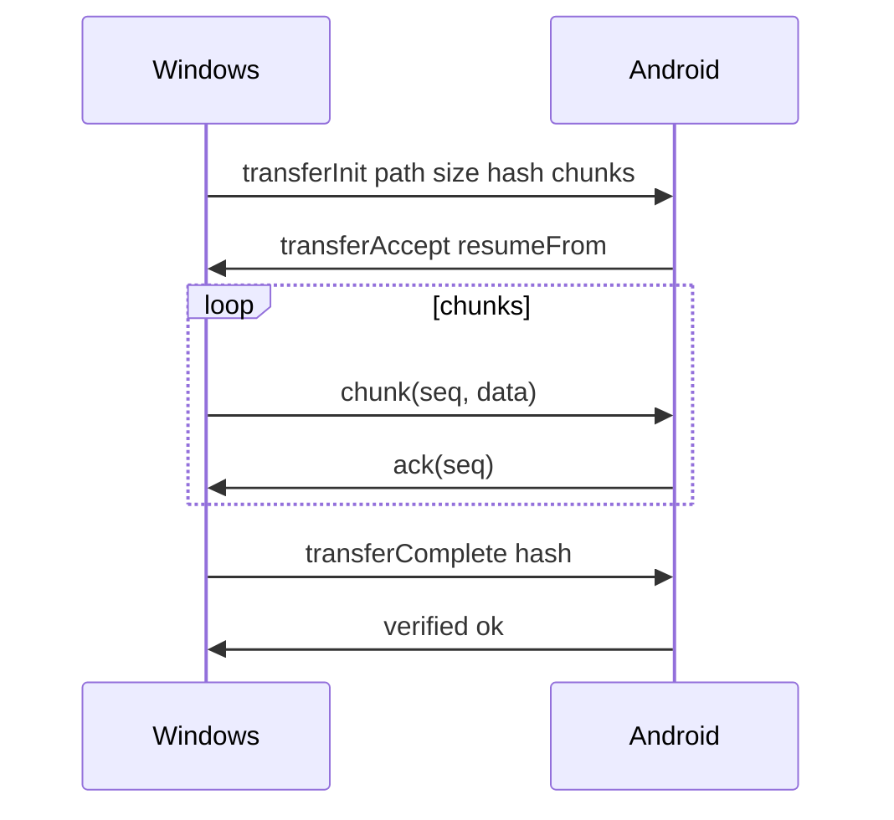

# План 07 — Движок передачи файлов

## Цель

Реализовать надёжную передачу файлов между устройствами: чанки, докачка (resume), проверка целостности (SHA-256), многопоточность и очередь.

## Зависимости

[`plans/02-protocol-and-network.md`](02-protocol-and-network.md)

## Протокол передачи

## Компоненты (core)

- **TransferManager** — очередь, приоритеты, лимит параллельных потоков.
- **ChunkedSender/Receiver** — разбиение на чанки (например, 256 КБ–1 МБ).
- **ResumeStore** — сохранение прогресса (SQLDelight): fileId, offset, hash, target.
- **IntegrityCheck** — SHA-256 по завершении, сравнение.
- **Backpressure** — управление скоростью при медленном канале/диске.
- **Throttling** — ограничение скорости (опционально).

## Возможности

- Пауза/возобновление/отмена передач.
- Параллельная передача нескольких файлов.
- Докачка после обрыва соединения (по сохранённому offset).
- Передача папок рекурсивно (обход + постановка файлов в очередь).
- Прогресс/скорость/ETA, агрегированный прогресс по папке.
- Проверка свободного места перед записью.

## Шаги реализации

1. Определить сообщения `transferInit/accept/chunk/ack/complete/verify`.
2. Реализовать бинарный файловый канал поверх TLS с чанковым протоколом.
3. Реализовать `ResumeStore` для возобновления после перезапуска.
4. Реализовать очередь и параллелизм с ограничениями.
5. Реализовать проверку целостности и обработку повреждённых чанков.
6. Реализовать рекурсивную передачу папок.
7. Добавить UI прогресса и управления.

## Краевые случаи

- Изменение исходного файла во время передачи — пересчёт хеша/повтор.
- Недостаток места — остановка с понятной ошибкой.
- Блокировка файла антивирусом/системой — ретраи.
- Обрыв на середине — докачка с последнего подтверждённого чанка.
- Очень большие файлы (гигабайты) — потоковая обработка без загрузки в память.

## Критерии готовности

- [x] Передача больших файлов с докачкой и проверкой хеша (SHA-256).
- [x] Устойчивость к обрывам: докачка по сохранённому размеру/прогрессу (UPLOAD/DOWNLOAD).
- [x] Отмена и прогресс (событие-протоколы `transferProgress`/`transferAbort`, список `TransferJob`).
- [x] Передача папок рекурсивно (`uploadFolder`/`downloadFolder`) с агрегированным прогрессом.
- [x] Очередь с лимитом параллельных потоков и приоритетами ([`TransferQueue`](core/src/commonMain/kotlin/ru/efir/core/transfer/TransferQueue.kt)).
- [x] `ResumeStore` для докачки после перезапуска ([`ResumeStore`](core/src/commonMain/kotlin/ru/efir/core/transfer/ResumeStore.kt); file-backed sidecar, БД — опционально позже).
- [x] Backpressure при отдаче (окно неподтверждённых чанков + ACK), проверка свободного места до приёма.
- [x] UI: прогресс-бар, скорость/ETA, агрегированный прогресс по папке.
- [x] Throttling (ограничение полосы) — [`RateLimiter`](core/src/commonMain/kotlin/ru/efir/core/transfer/RateLimiter.kt),
  лимит в [`TransferEngine.throttleBytesPerSecond`](core/src/commonMain/kotlin/ru/efir/core/transfer/TransferEngine.kt).
- [x] Возобновление очереди после перезапуска приложения (persist очереди) —
  [`TransferQueueStore`](core/src/commonMain/kotlin/ru/efir/core/transfer/TransferQueueStore.kt)
  - [`FileTransferQueueStore`](core/src/jvmCommon/kotlin/ru/efir/core/transfer/FileTransferQueueStore.kt),
  UI-блок «Незавершённые передачи» с возобновлением/сбросом.

## Что реализовано (итерация 1)

- Бинарный чанк-кодек: [`TransferFrameCodec`](core/src/commonMain/kotlin/ru/efir/core/transfer/TransferFrame.kt)
  (`DATA`/`ACK`, transferId/seq/offset/payload) + тесты.
- SHA-256: [`Sha256`](core/src/commonMain/kotlin/ru/efir/core/transfer/Sha256.kt) (`expect`)
  - JVM-реализация [`Sha256.jvm.kt`](core/src/jvmCommon/kotlin/ru/efir/core/transfer/Sha256.jvm.kt),
  утилиты [`Sha256Util`](core/src/commonMain/kotlin/ru/efir/core/transfer/Sha256.kt).
- Модели: [`TransferModels`](core/src/commonMain/kotlin/ru/efir/core/transfer/TransferModels.kt)
  (`TransferDirection`/`TransferStatus`/`TransferJob`).
- Движок: [`TransferEngine`](core/src/commonMain/kotlin/ru/efir/core/transfer/TransferEngine.kt) —
  хост (`attachHost`: приём `UPLOAD`, отдача `DOWNLOAD`) и инициатор
  (`attachClient`, `uploadFile`/`downloadFile`, `uploadFolder`/`downloadFolder`, `cancel`),
  докачка, буферизация ранних чанков, проверка хеша, прогресс.
- Расширен [`FileSystem`](core/src/commonMain/kotlin/ru/efir/core/files/FileModels.kt):
  `size`/`append`/`prepareWriteTarget`/`sha256`/`freeSpace` (+ [`LocalFileSystem`](core/src/jvmCommon/kotlin/ru/efir/core/files/LocalFileSystem.kt)).
- Протокол [`TransferMessages`](core/src/commonMain/kotlin/ru/efir/core/protocol/TransferMessages.kt):
  `TransferRejected`, `TransferChunkAck`, `TransferFinished`, `resumeFrom`/`chunkSize`/`totalSize`.
- Мультиплексирование бинарного канала в [`EfirSession`](core/src/commonMain/kotlin/ru/efir/core/net/EfirSession.kt):
  файловые фреймы отделены от медиа (`incomingFileFrames`/`incomingMediaFrames`);
  у [`RpcSession`](core/src/commonMain/kotlin/ru/efir/core/protocol/RpcSession.kt) добавлен `sendEvent`.
- Интеграция: [`EfirController`](core/src/commonMain/kotlin/ru/efir/core/app/EfirController.kt)
  (`transfers`, `uploadFile`/`downloadFile`/`uploadFolder`/`downloadFolder`/`cancelTransfer`).
- UI: секция [`TransfersSection`](core/src/commonMain/kotlin/ru/efir/core/app/EfirAppScreen.kt) + кнопка «Скачать».
- Тесты: [`TransferFrameCodecTest`](core/src/commonTest/kotlin/ru/efir/core/transfer/TransferFrameCodecTest.kt)
  и сквозной [`TransferIntegrationTest`](core/src/desktopTest/kotlin/ru/efir/core/transfer/TransferIntegrationTest.kt) (upload/download).

## Что реализовано (итерация 2)

- Очередь передач [`TransferQueue`](core/src/commonMain/kotlin/ru/efir/core/transfer/TransferQueue.kt):
  лимит одновременных задач (`maxConcurrent`, по умолчанию 3), приоритеты
  ([`TransferPriority`](core/src/commonMain/kotlin/ru/efir/core/transfer/TransferModels.kt)),
  приоритетный запуск и корректная отмена ожидающих. Настраивается из
  [`EfirController.maxConcurrentTransfers`](core/src/commonMain/kotlin/ru/efir/core/app/EfirController.kt).
- Backpressure при `DOWNLOAD`: отдача ждёт ACK после окна неподтверждённых
  чанков (`ACK_WINDOW`), получатель подтверждает чанки ([`TransferFrameCodec.encodeAck`](core/src/commonMain/kotlin/ru/efir/core/transfer/TransferFrame.kt)).
- Проверка изменения исходного файла во время отдачи (по mtime из
  [`TransferInit.sourceModifiedAt`](core/src/commonMain/kotlin/ru/efir/core/protocol/TransferMessages.kt)).
- [`ResumeStore`](core/src/commonMain/kotlin/ru/efir/core/transfer/ResumeStore.kt):
  in-memory и file-backed (`FileResumeStore`, sidecar `.efirpart`); хост сохраняет
  прогресс приёма и очищает его после успешной проверки — докачка после перезапуска.
- Передача папок: сначала сбор файлов, затем параллельный запуск через очередь
  (`launchTransfers`), общий `groupId`/`groupLabel`; агрегация
  [`aggregateGroups`](core/src/commonMain/kotlin/ru/efir/core/transfer/TransferModels.kt)
  (`TransferGroup`).
- Модели [`TransferJob`](core/src/commonMain/kotlin/ru/efir/core/transfer/TransferModels.kt):
  скорость (`speedBytesPerSecond`), ETA (`etaSeconds`), `priority`, `group`, `canResume`, времена.
- UI [`TransfersSection`](core/src/commonMain/kotlin/ru/efir/core/app/EfirAppScreen.kt):
  `LinearProgressIndicator`, скорость/ETA, агрегированный прогресс по папкам,
  кнопка «Отменить» для активных передач.
- Тесты: [`TransferQueueTest`](core/src/commonTest/kotlin/ru/efir/core/transfer/TransferQueueTest.kt),
  [`TransferGroupingTest`](core/src/commonTest/kotlin/ru/efir/core/transfer/TransferGroupingTest.kt),
  [`TransferFolderIntegrationTest`](core/src/desktopTest/kotlin/ru/efir/core/transfer/TransferFolderIntegrationTest.kt).

## Что реализовано (итерация 3)

- **Throttling**: [`RateLimiter`](core/src/commonMain/kotlin/ru/efir/core/transfer/RateLimiter.kt)
  (token bucket); применяется при отдаче (`DOWNLOAD`) и отправке (`UPLOAD`). Лимит
  задаётся через `TransferEngine.throttleBytesPerSecond` и `EfirController.transferThrottleBytesPerSecond`.
- Тест: [`RateLimiterTest`](core/src/commonTest/kotlin/ru/efir/core/transfer/RateLimiterTest.kt).

## Что реализовано (итерация 4)

- **Persist очереди**: [`TransferQueueStore`](core/src/commonMain/kotlin/ru/efir/core/transfer/TransferQueueStore.kt)
  (интерфейс + [`InMemoryTransferQueueStore`](core/src/commonMain/kotlin/ru/efir/core/transfer/TransferQueueStore.kt))
  и персистентное [`FileTransferQueueStore`](core/src/jvmCommon/kotlin/ru/efir/core/transfer/FileTransferQueueStore.kt)
  (JSON-файл, атомарная запись; Android — `filesDir`, Desktop — `~/.efir`).
- Модель [`QueuedTransfer`](core/src/commonMain/kotlin/ru/efir/core/transfer/TransferQueueStore.kt)
  (сериализуемая) с направлением, путями, прогрессом, приоритетом, группой и флагом перезаписи.
- [`TransferEngine`](core/src/commonMain/kotlin/ru/efir/core/transfer/TransferEngine.kt):
  сохранение задачи при постановке, троттлинг обновлений прогресса на диск,
  снятие с возобновления при завершении/сбросе; методы `pendingTransfers`,
  `refreshPending`/`resume(id)`/`resumeAll`/`discard(id)`/`discardAll`.
- [`EfirController`](core/src/commonMain/kotlin/ru/efir/core/app/EfirController.kt):
  `pendingTransfers` и методы возобновления/сброса; `transferQueueStore` в конструкторе.
- UI [`TransfersSection`](core/src/commonMain/kotlin/ru/efir/core/app/EfirAppScreen.kt):
  карточка «Незавершённые передачи» с прогрессом и кнопками
  «Возобновить»/«Убрать»/«Возобновить все»/«Сбросить все».
- Тесты: [`TransferQueueStoreTest`](core/src/commonTest/kotlin/ru/efir/core/transfer/TransferQueueStoreTest.kt),
  [`FileTransferQueueStoreTest`](core/src/desktopTest/kotlin/ru/efir/core/transfer/FileTransferQueueStoreTest.kt).

## Осталось по блоку 07

- Полноценное хранилище прогресса на SQLDelight (если понадобится индексирование/история).
