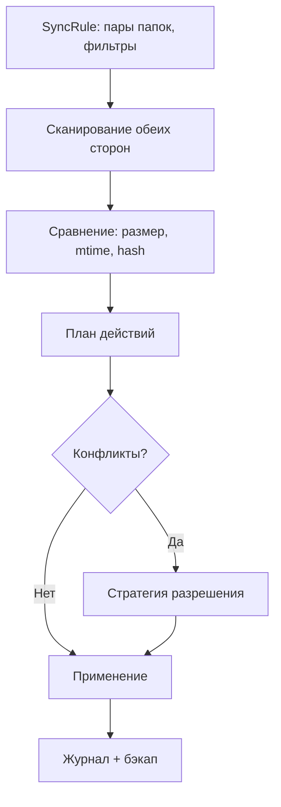

# План 08 — Движок синхронизации папок

## Цель

Реализовать максимально гибкую двустороннюю синхронизацию выбранных пар папок с настраиваемыми триггерами, правилами и стратегиями разрешения конфликтов.

## Зависимости

[`plans/06-file-manager.md`](06-file-manager.md), [`plans/07-file-transfer-engine.md`](07-file-transfer-engine.md)

## Модель синхронизации

## Сущности (SQLDelight)

- `sync_rules`: id, name, localPath, remotePath, direction, schedule, options, enabled.
- `sync_state`: ruleId, relPath, size, mtime, hash, lastSyncedAt, side.
- `sync_journal`: события (создано/обновлено/удалено/переименовано/конфликт).
- `sync_versions`: история/бэкап перезаписанных файлов.

## Триггеры запуска

- **Вручную** — кнопка «Синхронизировать сейчас».
- **По расписанию** — интервал (мин/час) или конкретное время/день.
- **Автоматически при подключении** — старт при установке соединения.
- **По изменению в реальном времени** — наблюдатели файловой системы (Android `FileObserver`, Windows `WatchService`).

## Правила включения/исключения

- Маски имён (`*.tmp`, `.git/**`, `node_modules`).
- Ограничения по размеру, типу, дате.
- Игнорирование временных/системных файлов.

## Стратегии (максимум гибкости)

- **Слияние** — объединять содержимое обеих сторон, не удаляя без необходимости.
- **Замещение** — перезапись более новым (по mtime) или выбранной стороной.
- **Добавление** — только добавлять новое, не удалять.
- **Приоритет стороны** — ПК → телефон, телефон → ПК, «самый новый».
- **Автопереименование при коллизиях** — `name (1).ext`, `name (2).ext`.
- **Ручное разрешение** — список конфликтов в UI с выбором по каждому.
- Опции: удалять ли файлы, удалённые на другой стороне (mirror vs merge).

## Шаги реализации

1. Определить сущности и миграции SQLDelight.
2. Реализовать `Scanner`: обход папок с фильтрами, сбор метаданных + хешей.
3. Реализовать `Differ`: сравнение состояний, выявление add/update/delete/conflict.
4. Реализовать `Planner`: построение плана действий с учётом стратегии.
5. Реализовать `Applier`: выполнение через TransferManager, бэкап перезаписанного.
6. Реализовать планировщик триггеров (ручной/расписание/подключение/watcher).
7. Реализовать журнал и восстановление из версий.

## Краевые случаи

- Одновременное изменение одного файла с обеих сторон — конфликт.
- Переименование vs удаление+создание — эвристика (по hash).
- Частичные/временные файлы — исключать до завершения.
- Большие объёмы — инкрементальная синхронизация по состоянию.
- Изменения во время синхронизации — дождаться/повторить.

## Критерии готовности

- [x] Триггеры: ручной, расписание, подключение + интерфейс real-time watcher.
- [x] Стратегии конфликтов: слияние/замещение/добавление/приоритеты/переименование/спросить.
- [x] Журнал операций; ручное разрешение конфликтов (стратегия `ASK` возвращает список).
- [x] Инкрементальная синхронизация по базовой линии (обе стороны отдельно).
- [x] Бэкап перезаписанных файлов в хранилище версий
  ([`SyncVersionStore`](core/src/commonMain/kotlin/ru/efir/core/sync/SyncVersionStore.kt),
  [`SyncEngine`](core/src/commonMain/kotlin/ru/efir/core/sync/SyncEngine.kt): `versions`/`restoreVersion`).
- [ ] Полноценное хранилище на SQLDelight (пока — JSON-файлы/in-memory).

## Что реализовано (итерация 1)

- Протокол [`SyncMessages`](core/src/commonMain/kotlin/ru/efir/core/protocol/SyncMessages.kt):
  `SyncRuleConfig` (направление, триггер, интервал расписания, стратегия, фильтры по
  маскам/размеру, распространение удалений), `SyncAction` (тип, сторона, признак
  каталога, `newName`), `SyncConflict`, `SyncPlanRequest`/`SyncPlanResult`.
- Модели [`SyncModels`](core/src/commonMain/kotlin/ru/efir/core/sync/SyncModels.kt):
  `SyncFileNode`, `SyncSnapshot`, `SyncBaseline` (состояние каждой стороны отдельно),
  `SyncFileDiff`, `SyncSideChange`, `SyncJournal`/`SyncJournalEntry`.
- Фильтр [`PathFilter`](core/src/commonMain/kotlin/ru/efir/core/sync/PathFilter.kt):
  glob-маски (`*`, `?`, `**`) include/exclude, ограничения по размеру, автоигнор
  временных файлов (`.tmp`, `.efirpart`, `~$*`, …).
- Сканер [`SyncScanner`](core/src/commonMain/kotlin/ru/efir/core/sync/SyncScanner.kt):
  рекурсивный обход одной стороны с фильтрами и опциональным SHA-256.
- Differ [`SyncDiffer`](core/src/commonMain/kotlin/ru/efir/core/sync/SyncDiffer.kt):
  классификация add/modify/remove относительно базовой линии и детект конфликтов.
- Планировщик [`SyncPlanner`](core/src/commonMain/kotlin/ru/efir/core/sync/SyncPlanner.kt):
  построение плана с учётом направления и всех стратегий (включая автопереименование
  `name (1).ext` и `ASK` → список конфликтов).
- Хранилище [`SyncStateStore`](core/src/commonMain/kotlin/ru/efir/core/sync/SyncStateStore.kt):
  in-memory + персистентное [`FileSyncStateStore`](core/src/jvmCommon/kotlin/ru/efir/core/sync/FileSyncStateStore.kt)
  (JSON-файлы правил/базовых линий/журнала, атомарная запись).
- Адаптеры [`SyncAdapters`](core/src/commonMain/kotlin/ru/efir/core/sync/SyncAdapters.kt):
  `SyncRemoteFs` поверх [`FileManagerClient`](core/src/commonMain/kotlin/ru/efir/core/files/FileManagerClient.kt),
  `SyncTransfer` поверх [`TransferEngine`](core/src/commonMain/kotlin/ru/efir/core/transfer/TransferEngine.kt).
- Движок [`SyncEngine`](core/src/commonMain/kotlin/ru/efir/core/sync/SyncEngine.kt):
  цикл scan→diff→plan→apply→journal→baseline, порядок действий (каталоги→файлы→удаления),
  публикация прогресса `SyncRunStatus`.
- Планировщик триггеров [`SyncScheduler`](core/src/commonMain/kotlin/ru/efir/core/sync/SyncScheduler.kt):
  расписание, при подключении, интерфейс `SyncWatcher` для изменений в реальном времени.
- Интеграция в [`EfirController`](core/src/commonMain/kotlin/ru/efir/core/app/EfirController.kt):
  правила, запуск, dry-run, журнал; UI-секция в [`EfirAppScreen`](core/src/commonMain/kotlin/ru/efir/core/app/EfirAppScreen.kt).
- Тесты: [`PathFilterTest`](core/src/commonTest/kotlin/ru/efir/core/sync/PathFilterTest.kt),
  [`SyncPlannerTest`](core/src/commonTest/kotlin/ru/efir/core/sync/SyncPlannerTest.kt),
  [`SyncEngineTest`](core/src/commonTest/kotlin/ru/efir/core/sync/SyncEngineTest.kt).

## Что реализовано (итерация 2)

- **Версии/бэкапы**: [`SyncVersionStore`](core/src/commonMain/kotlin/ru/efir/core/sync/SyncVersionStore.kt)
  (in-memory + файлы-бэкапы `.efirbackup.<ts>` рядом с оригиналом). Перед перезаписью
  локальной цели движок делает резервную копию, если включён `backupBeforeOverwrite`.
  Методы истории/восстановления: `SyncEngine.versions`/`allVersions`/`restoreVersion`/`clearVersions`;
  прокси в [`EfirController`](core/src/commonMain/kotlin/ru/efir/core/app/EfirController.kt).
- Тесты: [`SyncVersionStoreTest`](core/src/commonTest/kotlin/ru/efir/core/sync/SyncVersionStoreTest.kt).

## Что реализовано (итерация 3)

- **Наблюдатели ФС (реальный `SyncWatcher`)**: `expect fun createLocalSyncWatcher()`
  в [`SyncScheduler`](core/src/commonMain/kotlin/ru/efir/core/sync/SyncScheduler.kt);
  - Windows/ПК — [`SyncWatcher.desktop.kt`](core/src/desktopMain/kotlin/ru/efir/core/sync/SyncWatcher.desktop.kt)
    на `java.nio.WatchService` (рекурсивная регистрация каталогов, дебаунс);
  - Android — [`SyncWatcher.android.kt`](core/src/androidMain/kotlin/ru/efir/core/sync/SyncWatcher.android.kt)
    на `FileObserver` (`MAX_OBSERVERS=256`, `MAX_DEPTH=8`).
- Подключён в [`EfirController.setupSync`](core/src/commonMain/kotlin/ru/efir/core/app/EfirController.kt):
  `watcher = runCatching { createLocalSyncWatcher() }.getOrNull()` — триггер `ON_CHANGE`
  теперь работает в реальном времени на обеих платформах.

## Осталось по блоку 08

- Резервное копирование при перезаписи **удалённой** цели (нужен read-доступ через `SyncRemoteFs`).
- Хранилище на SQLDelight при росте объёмов/необходимости индексации.
