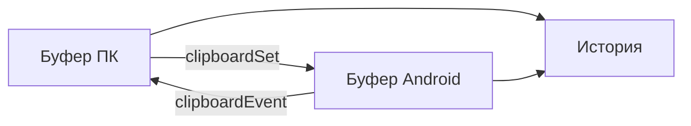

# План 10 — Общий буфер обмена и уведомления

## Цель

Реализовать синхронизацию буфера обмена между ПК и телефоном и зеркалирование уведомлений Android на ПК.

## Зависимости

[`plans/02-protocol-and-network.md`](02-protocol-and-network.md)

## Буфер обмена

- Двусторонняя синхронизация текста (изображения — опционально позже).
- Сообщения `clipboardSet`/`clipboardGet`/`clipboardEvent`.
- **Ограничение:** Android 10+ блокирует фоновый доступ к буферу; синхронизация возможна, когда приложение/служба активна (foreground). Использовать `ClipboardManager` и, при необходимости, AccessibilityService для отслеживания.
- История буфера с поиском и закреплением.

## Уведомления

- **NotificationListenerService** на Android — чтение уведомлений.
- Передача `notificationPost`/`notificationRemove` на ПК (заголовок, текст, приложение, иконка, время).
- Отображение как системные уведомления Windows (или в панели приложения).
- Быстрые действия (отклонить/ответить) где поддерживается.
- Группировка по приложениям, фильтры (какие приложения зеркалировать).

## Шаги реализации

1. Реализовать синхронизацию текстового буфера и историю.
2. Реализовать NotificationListenerService и отправку уведомлений.
3. Реализовать отображение/управление уведомлениями на ПК.
4. Реализовать фильтры и настройки (вкл/выкл, выбор приложений).
5. Обработать ограничения фонового доступа к буферу и подсказать пользователю.

## Краевые случаи

- Циклическая синхронизация (эхо) — маркеры источника.
- Большой объём в буфере — лимит/предупреждение.
- Уведомления с медиа-контентом (обложки) — извлечение иконок.
- Отключённая служба — подсказать включить.

## Критерии готовности

- [x] Копирование текста синхронизируется в обе стороны (с подавлением эха).
- [x] История буфера с поиском/закреплением (закрепление + очистка).
- [x] Уведомления Android отображаются на ПК.
- [ ] Настройки фильтров и вкл/выкл (фильтры по приложениям — позже).

## Что реализовано (итерация 1)

- Ядро [`ClipboardSync`](core/src/commonMain/kotlin/ru/efir/core/comms/ClipboardSync.kt):
  опрос системного буфера, история с дедупликацией и закреплением, подавление эха
  при применении удалённого значения.
- Платформенный буфер: desktop (AWT) [`LocalClipboard.desktop.kt`](core/src/desktopMain/kotlin/ru/efir/core/comms/LocalClipboard.desktop.kt),
  Android (`ClipboardManager`) [`LocalClipboard.android.kt`](core/src/androidMain/kotlin/ru/efir/core/comms/LocalClipboard.android.kt).
- Обмен по протоколу [`CommsControl`](core/src/commonMain/kotlin/ru/efir/core/comms/CommsControl.kt):
  `ClipboardHost`/`ClipboardClient` (`clipboardSet`/`clipboardGet`/`clipboardChanged`),
  `NotificationsHost`/`NotificationsClient` (`notificationPosted`/`notificationRemoved`).
- Android-служба [`EfirNotificationListenerService`](core/src/androidMain/kotlin/ru/efir/core/comms/EfirNotificationListenerService.kt)
  - держатель [`EfirAndroidEnvironment`](core/src/androidMain/kotlin/ru/efir/core/comms/EfirAndroidEnvironment.kt),
  зарегистрирована в [`AndroidManifest.xml`](androidApp/src/main/AndroidManifest.xml).
- Интеграция в [`EfirController`](core/src/commonMain/kotlin/ru/efir/core/app/EfirController.kt)
  и UI-секция [`CommsSection`](core/src/commonMain/kotlin/ru/efir/core/app/EfirAppScreen.kt).
- Тесты: [`ClipboardSyncTest`](core/src/commonTest/kotlin/ru/efir/core/comms/ClipboardSyncTest.kt).

## Что реализовано (итерация 2)

- **Фильтры уведомлений**: [`NotificationFilter`](core/src/commonMain/kotlin/ru/efir/core/comms/NotificationFilter.kt)
  — вкл/выкл зеркалирования, чёрный список пакетов, белый список и скрытие
  «постоянных» (ongoing) уведомлений.
- Фильтр применяется и на стороне-источнике ([`NotificationsHost`](core/src/commonMain/kotlin/ru/efir/core/comms/CommsControl.kt)
  не отправляет отфильтрованное), и на клиенте ([`NotificationsClient`](core/src/commonMain/kotlin/ru/efir/core/comms/CommsControl.kt)
  — вторичная защита + перефильтрация накопленного списка).
- [`EfirController`](core/src/commonMain/kotlin/ru/efir/core/app/EfirController.kt):
  `notificationFilter`, `knownNotificationPackages`, методы
  `setNotificationsEnabled`/`setNotificationsHideOngoing`/`toggleNotificationPackage`.
- UI в [`CommsSection`](core/src/commonMain/kotlin/ru/efir/core/app/EfirAppScreen.kt):
  переключатели зеркалирования/скрытия постоянных + список приложений с кнопками
  «Исключить/Показывать».
- Тесты: [`NotificationFilterTest`](core/src/commonTest/kotlin/ru/efir/core/comms/NotificationFilterTest.kt).

## Что реализовано (итерация 3)

- **Действия над уведомлениями (dismiss/ответ с ПК)**: expect/actual
  [`NotificationActions`](core/src/commonMain/kotlin/ru/efir/core/comms/NotificationActions.kt)
  (`dismissRemoteNotification`/`replyRemoteNotification`,
  [Android](core/src/androidMain/kotlin/ru/efir/core/comms/NotificationActions.android.kt)
  через `NotificationListenerService.cancelNotification` и `RemoteInput`,
  desktop — заглушки).
- Протокол [`CommsMessages`](core/src/commonMain/kotlin/ru/efir/core/protocol/CommsMessages.kt):
  `notificationDismiss`, `notificationReply` (RPC) и `notificationActionResult`.
- [`NotificationsHost`](core/src/commonMain/kotlin/ru/efir/core/comms/CommsControl.kt)
  (`attach()` регистрирует обработчики) и [`NotificationsClient`](core/src/commonMain/kotlin/ru/efir/core/comms/CommsControl.kt)
  (`dismiss`/`reply`).
- [`EfirController`](core/src/commonMain/kotlin/ru/efir/core/app/EfirController.kt):
  `canControlNotifications`, `dismissNotification`, `replyToNotification`.
- UI: кнопки «Закрыть»/«Ответить» с полем ввода для каждого уведомления.

## Осталось по блоку 10

- Синхронизация изображений в буфере.
