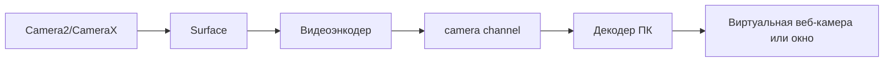

# План 11 — Трансляция камеры, микрофона и звука

## Цель

Передавать изображение с камеры Android на ПК (режим веб-камеры), а также микрофон и системный звук телефона.

## Зависимости

[`plans/02-protocol-and-network.md`](02-protocol-and-network.md), [`plans/04-screen-capture-and-stream.md`](04-screen-capture-and-stream.md) (переиспользование медиа-пайплайна)

## Камера

- Захват через **CameraX** (или Camera2), выбор камеры (фронт/тыл), разрешение, FPS.
- Кодирование H.264 (аппаратное), передача по аналогии с экраном.
- На ПК: либо окно предпросмотра, либо **виртуальная камера** (опционально, требует драйвера — вынести в отдельный опциональный этап).

## Микрофон

- **AudioRecord** → AAC/Opus → поток → воспроизведение на ПК.
- Управление уровнем, выбор источника (микрофон/голос).

## Системный звук

- **AudioPlaybackCapture** (Android 10+) для захвата звука приложений (где разрешено политикой).
- Ограничения: некоторые приложения запрещают захват (`ALLOW_CAPTURE_BY_NONE`).
- Передача Opus/AAC → воспроизведение на ПК.

## Шаги реализации

1. Реализовать захват камеры и видео-поток.
2. Реализовать окно предпросмотра камеры на ПК.
3. Реализовать передачу микрофона и воспроизведение на ПК.
4. Реализовать захват системного звука (где разрешено).
5. Реализовать настройки (камера, разрешение, источник звука).
6. (Опционально) виртуальная веб-камера на Windows.

## Краевые случаи

- Занятая камера/микрофон другим приложением.
- Разные форматы/частоты дискретизации — ресемплинг.
- Задержка звука и рассинхрон с видео — буферизация и синхронизация.
- Приложения, запрещающие захват звука.

## Критерии готовности

- [x] Предпросмотр камеры телефона на ПК (Camera2 → JPEG → CAMERA-канал).
- [x] Микрофон телефона слышен на ПК (`AudioRecord` → PCM16 → воспроизведение).
- [x] Системный звук транслируется где разрешено (`AudioPlaybackCapture`, Android 10+).
- [x] Настройки выбора камеры (фронт/тыл) и источника звука.

## Что реализовано (итерация 1)

- Абстракции [`CameraCapture`](core/src/commonMain/kotlin/ru/efir/core/media/CameraCapture.kt)
  (`CameraQuality`, `CameraCaptureSource`, `cameraCaptureSupported`, фабрика) и
  [`AudioCapture`](core/src/commonMain/kotlin/ru/efir/core/media/AudioCapture.kt)
  (`AudioQuality`, `AudioCaptureSource`, `AudioPlayer`, фабрики).
- Хосты [`CameraStreamHost`/`AudioStreamHost`](core/src/commonMain/kotlin/ru/efir/core/media/CameraAudioHost.kt):
  обработка `cameraStart`/`cameraStop`, `audioStart`/`audioStop`, отправка кадров
  по CAMERA/AUDIO-каналам бинарного потока.
- Единый клиент [`MediaStreamClient`](core/src/commonMain/kotlin/ru/efir/core/media/MediaStreamClient.kt):
  одна подписка на медиа-канал с маршрутизацией SCREEN/CAMERA/AUDIO (важно — канал
  доставляет кадр только одному подписчику).
- Android: [`CameraCapture.android.kt`](core/src/androidMain/kotlin/ru/efir/core/media/CameraCapture.android.kt)
  (Camera2 + JPEG), [`AudioCapture.android.kt`](core/src/androidMain/kotlin/ru/efir/core/media/AudioCapture.android.kt)
  (`AudioRecord`, `AudioPlaybackCapture`).
- Desktop: [`CameraCapture.desktop.kt`](core/src/desktopMain/kotlin/ru/efir/core/media/CameraCapture.desktop.kt)
  (не поддерживается), [`AudioCapture.desktop.kt`](core/src/desktopMain/kotlin/ru/efir/core/media/AudioCapture.desktop.kt)
  (воспроизведение через `javax.sound`).
- Интеграция в [`EfirController`](core/src/commonMain/kotlin/ru/efir/core/app/EfirController.kt)
  и UI-секция [`CameraAudioSection`](core/src/commonMain/kotlin/ru/efir/core/app/EfirAppScreen.kt).
- Тесты: [`MediaQualityTest`](core/src/commonTest/kotlin/ru/efir/core/media/MediaQualityTest.kt)
  - существующий [`MediaFrameCodecTest`](core/src/commonTest/kotlin/ru/efir/core/media/MediaFrameCodecTest.kt).

## Осталось по блоку 11

- Виртуальная веб-камера на Windows (опциональный драйвер).
- H.264/AAC вместо JPEG/PCM16 для экономии полосы.
- Синхронизация аудио/видео по меткам времени (буферизация).
