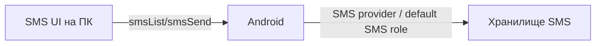

# План 12 — SMS и звонки с ПК

## Цель

Дать доступ к SMS и звонкам Android с ПК: чтение/отправка SMS, отображение и управление входящими звонками.

## Зависимости

[`plans/02-protocol-and-network.md`](plans/02-protocol-and-network.md), [`plans/10-clipboard-and-notifications.md`](10-clipboard-and-notifications.md)

## SMS

- Чтение SMS через `Telephony.Sms` provider (нужны разрешения `READ_SMS`).
- Отправка через `SmsManager`; для полноценной работы — роль **default SMS app** (Android 4.4+) либо согласие пользователя.
- Диалоги/треды, поиск, отметка прочитанным, уведомления о новых.
- Отображение входящих SMS в реальном времени (broadcast receiver).

## Звонки

- Индикация входящего звонка (`TelecomManager`/`PhoneStateListener`).
- Действия: принять/отклонить (требует `ANSWER_PHONE_CALLS` и разрешений; принятие ограничено политиками версии).
- История вызовов (`CallLog` provider).
- Уведомление о пропущенных.

## Разрешения (Android)

- `READ_SMS`, `RECEIVE_SMS`, `SEND_SMS`.
- `READ_PHONE_STATE`, `READ_CALL_LOG`, `ANSWER_PHONE_CALLS`, `CALL_PHONE`.
- Роль default SMS app (для отправки/полного доступа).
- Обязательное информирование пользователя о причинах запроса.

## Шаги реализации

1. Реализовать чтение и отображение SMS (треды, поиск).
2. Реализовать отправку SMS и обработку статуса доставки.
3. Реализовать реал-тайм приём SMS.
4. Реализовать индикацию и действия по звонкам, историю вызовов.
5. Реализовать UI на ПК (единый мессенджер-подобный вид).
6. Реализовать запрос и обработку разрешений.

## Краевые случаи

- Отсутствие роли default SMS app — ограниченная функциональность.
- Двойная SIM — выбор SIM для отправки.
- Отклонённые разрешения — деградация с понятными сообщениями.
- Ограничения принятия звонков на новых версиях Android.

## Критерии готовности

- [x] Просмотр и отправка SMS с ПК (`smsList`/`smsSend`).
- [x] Реал-тайм приём (`BroadcastReceiver` → `smsReceived`).
- [x] Выбор SIM при двойной SIM (`smsSubscriptions` + `smsSend.subscriptionId`).
- [x] Статусы доставки (`smsDeliveryStatus`: SENT/DELIVERED/FAILED).
- [x] Индикация и управление звонками (события + действия через `TelecomManager`).
- [x] Разрешения запрашиваются на уровне манифеста и runtime; роль default SMS app
  запрашивается кнопкой.

## Что реализовано (итерация 1)

- Абстракция [`SmsRepository`](core/src/commonMain/kotlin/ru/efir/core/comms/SmsRepository.kt)
  (`list`/`send`/`markRead`/`incoming`, `expect`-фабрика).
- Хосты/клиенты [`SmsControl`](core/src/commonMain/kotlin/ru/efir/core/comms/SmsControl.kt):
  `SmsHost`/`SmsClient` (`smsList`/`smsSend`/`smsReceived`),
  `CallHost`/`CallClient` (`callStateChanged`/`callAction`).
- Протокол: добавлен [`CallActionResult`](core/src/commonMain/kotlin/ru/efir/core/protocol/CommsMessages.kt).
- Android: [`SmsRepository.android.kt`](core/src/androidMain/kotlin/ru/efir/core/comms/SmsRepository.android.kt)
  (`Telephony.Sms` + `SmsManager`), приёмник
  [`EfirSmsReceiver`](core/src/androidMain/kotlin/ru/efir/core/comms/EfirSmsReceiver.kt).
- Desktop: [`SmsRepository.desktop.kt`](core/src/desktopMain/kotlin/ru/efir/core/comms/SmsRepository.desktop.kt)
  (не поддерживается).
- Разрешения и приёмник зарегистрированы в [`AndroidManifest.xml`](androidApp/src/main/AndroidManifest.xml).
- Интеграция в [`EfirController`](core/src/commonMain/kotlin/ru/efir/core/app/EfirController.kt)
  и UI-секция [`SmsCallsSection`](core/src/commonMain/kotlin/ru/efir/core/app/EfirAppScreen.kt).
- Тесты: [`SmsControlTest`](core/src/commonTest/kotlin/ru/efir/core/comms/SmsControlTest.kt).

## Что реализовано (итерация 2)

- **SMS-треды и история вызовов**: модели `SmsThread`/`CallLogEntry` и RPC
  `smsThreads`/`callLogList` ([`CommsMessages`](core/src/commonMain/kotlin/ru/efir/core/protocol/CommsMessages.kt)).
- [`SmsRepository`](core/src/commonMain/kotlin/ru/efir/core/comms/SmsRepository.kt):
  `threads()`/`callLog()`; Android-реализация читает `content://sms/` и
  `content://call_log/calls` ([`SmsRepository.android.kt`](core/src/androidMain/kotlin/ru/efir/core/comms/SmsRepository.android.kt)).
- [`SmsHost`/`SmsClient`](core/src/commonMain/kotlin/ru/efir/core/comms/SmsControl.kt):
  обработчики запросов и состояния `threads`/`callLog`.
- [`EfirController`](core/src/commonMain/kotlin/ru/efir/core/app/EfirController.kt):
  `smsThreads`, `callLog`, `loadSmsThreads`, `loadCallLog`.
- UI [`SmsCallsSection`](core/src/commonMain/kotlin/ru/efir/core/app/EfirAppScreen.kt):
  список диалогов с кнопкой «Открыть» и история вызовов с типами (⬅/➡/✖).

## Что реализовано (итерация 3)

- **Выбор SIM (двойная SIM)**: `SmsSubscription` + RPC `smsSubscriptions` →
  `smsSubscriptionsResult`; `SmsSend.subscriptionId`; Android — `SubscriptionManager`
  и `SmsManager.createForSubscriptionId`/`getSmsManagerForSubscriptionId`.
- **Статусы доставки**: `SmsDeliveryStatus` + событие `smsDeliveryStatus`;
  Android — `PendingIntent` на sent/delivery и приёмник
  [`EfirSmsStatusReceiver`](core/src/androidMain/kotlin/ru/efir/core/comms/EfirSmsStatusReceiver.kt);
  `SmsClient.deliveries` → UI-строка статуса.
- **Роль default SMS app**: [`SmsRole`](core/src/commonMain/kotlin/ru/efir/core/comms/SmsRole.kt)
  (`isDefaultSmsApp`/`requestDefaultSmsRole`), приём `SMS_DELIVER`, запись в
  «Отправленные» только при наличии роли; UI-подсказка на Android-хосте.
- **Реальные звонки**: [`CallController`](core/src/commonMain/kotlin/ru/efir/core/comms/CallController.kt)
  (expect/actual): `PhoneStateListener` → `callStateChanged` (флаг `incoming`),
  действия `ANSWER`/`REJECT`/`END` через `TelecomManager`; `CallClient.lastActionResult`.
- **Runtime-разрешения**: [`MainActivity`](androidApp/src/main/kotlin/ru/efir/android/MainActivity.kt)
  запрашивает SMS/телефонные разрешения при старте.
- **UI**: [`SmsCallsSection`](core/src/commonMain/kotlin/ru/efir/core/app/EfirAppScreen.kt)
  — выбор SIM, статусы доставки, иконки входящих/исходящих; секция
  `HostCommsSection` для роли default SMS app.
- **Тесты**: расширен [`SmsControlTest`](core/src/commonTest/kotlin/ru/efir/core/comms/SmsControlTest.kt)
  (подписки, статусы доставки, выбор SIM).

## Что реализовано (итерация 5)

- **Группировка тредов на стороне провайдера**: [`AndroidSmsRepository.threads()`](core/src/androidMain/kotlin/ru/efir/core/comms/SmsRepository.android.kt:94)
  больше не читает несуществующие колонки `snippet`/`message_count` из
  `content://sms/` — реальные сообщения сворачиваются в сводки общей функцией
  [`groupSmsThreads`](core/src/commonMain/kotlin/ru/efir/core/comms/SmsControl.kt:326)
  (сводка гарантированно совпадает с отображаемыми сообщениями).
- **Разрешение треда входящих SMS**: [`EfirSmsReceiver`](core/src/androidMain/kotlin/ru/efir/core/comms/EfirSmsReceiver.kt:29)
  находит существующий `thread_id` по адресу отправителя
  (`resolveThreadId`), а при роли default SMS app сохраняет `SMS_DELIVER` в
  провайдер (`persistIncoming`) — раньше входящие публиковались с `threadId = 0L`.
- **Группировка по адресу**: ключ треда — `threadId` при известном треде, иначе
  адрес отправителя (`smsThreadKey`), что не даёт смешать сообщения разных
  неизвестных отправителей в один диалог. Реал-тайм `mergeSmsThread` учитывает
  и адрес.
- **Тесты**: `groupSmsThreadsRespectsLimitAndOrder`,
  `groupSmsThreadsKeysUnknownThreadsByAddress`,
  `mergeSmsThreadMatchesUnknownThreadByAddress`
  ([`SmsControlTest`](core/src/commonTest/kotlin/ru/efir/core/comms/SmsControlTest.kt)).

## Что реализовано (итерация 4)

- **Реал-тайм треды SMS**: событие `smsReceived` обновляет сводку диалога на ПК
  без полной перезагрузки — чистые функции `groupSmsThreads`/`mergeSmsThread`
  в [`SmsControl`](core/src/commonMain/kotlin/ru/efir/core/comms/SmsControl.kt);
  `SmsClient.threads` обновляется на каждый входящий.
- **Исходящие звонки**: RPC `callInitiate` (`number` + `subscriptionId`),
  ответ — `callActionResult`; на Android — `TelecomManager.placeCall`
  (`CALL_PHONE`) в [`CallController.android.kt`](core/src/androidMain/kotlin/ru/efir/core/comms/CallController.android.kt);
  `CallHost`/`CallClient.initiate`, `EfirController.startCall`, кнопка «Позвонить» в UI.
- **Автозагрузка тредов** при подключении клиента (`sms.loadThreads()`).
- **Тесты**: `groupSmsThreadsAggregatesByThread`, `mergeSmsThreadCreatesOrBumps`,
  round-trip `CallInitiate` в [`ProtocolCodecTest`](core/src/commonTest/kotlin/ru/efir/core/protocol/ProtocolCodecTest.kt).

## Осталось по блоку 12

- Полный набор `SMS_DELIVER`-runtime для роли default SMS app: приём, запись в
  провайдер и группировка тредов реализованы (итерация 5); остаются
  push-уведомления о входящих (`NotificationManager`) и настройка MMS.
- Проверка корректности определения треда для MMS/коротких кодов (сейчас —
  только SMS).
