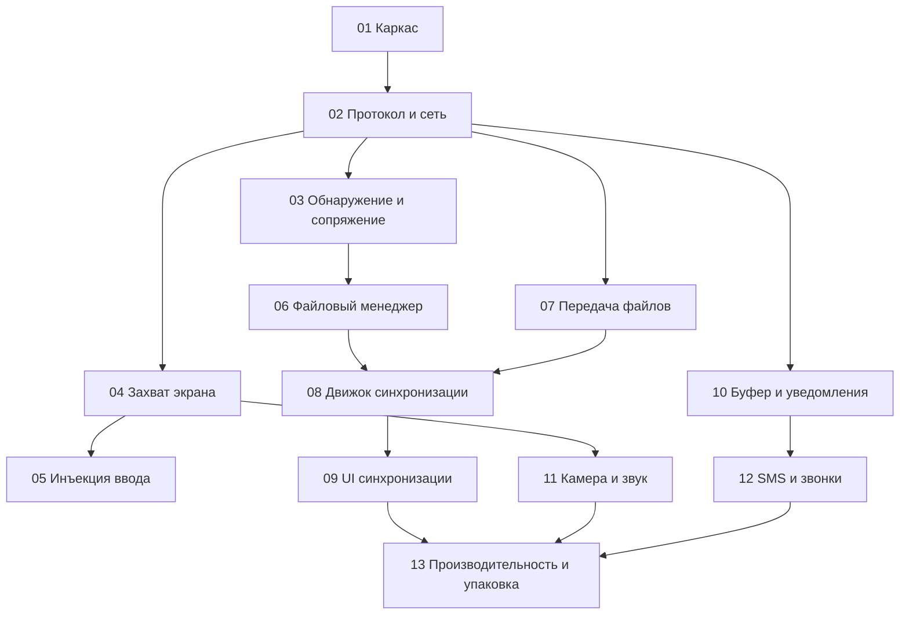

# Планы проекта Эфир

Индекс подробных планов по блокам. Общий обзор — в [`efir-plan.md`](efir-plan.md).

| # | План | Содержание | Зависит от |
| --- | ------ | ----------- | ----------- |
| 1 | [01-project-skeleton.md](01-project-skeleton.md) | Каркас KMP-проекта (core / androidApp / desktopApp) | — |
| 2 | [02-protocol-and-network.md](02-protocol-and-network.md) | Протокол, TLS, WebSocket, каналы | 1 |
| 3 | [03-discovery-and-pairing.md](03-discovery-and-pairing.md) | Обнаружение в LAN, QR + PIN, доверенные устройства | 1, 2 |
| 4 | [04-screen-capture-and-stream.md](04-screen-capture-and-stream.md) | MediaProjection, видео-поток, декод на ПК | 2 |
| 5 | [05-input-injection.md](05-input-injection.md) | AccessibilityService, тап/свайп/текст/клавиши | 2, 4 |
| 6 | [06-file-manager.md](06-file-manager.md) | Двусторонний файловый менеджер (SAF) | 2, 3 |
| 7 | [07-file-transfer-engine.md](07-file-transfer-engine.md) | Чанки, докачка, SHA-256, очередь | 2 |
| 8 | [08-sync-engine.md](08-sync-engine.md) | Движок синхронизации, триггеры, стратегии | 6, 7 |
| 9 | [09-sync-ui.md](09-sync-ui.md) | UI настроек и разрешения конфликтов | 8 |
| 10 | [10-clipboard-and-notifications.md](10-clipboard-and-notifications.md) | Буфер обмена и уведомления | 2 |
| 11 | [11-camera-audio.md](11-camera-audio.md) | Камера, микрофон, звук | 2, 4 |
| 12 | [12-sms-and-calls.md](12-sms-and-calls.md) | SMS и звонки | 2, 10 |
| 13 | [13-performance-and-packaging.md](13-performance-and-packaging.md) | Оптимизация, тесты, упаковка, документация | все |
| 14 | [14-symmetry-access-key-and-encryption.md](14-symmetry-access-key-and-encryption.md) | Равноправные устройства, ключ доступа 12 символов, TLS | 2, 3 |

## Статус реализации

| # | Блок | Статус |
| --- | ---- | ------ |
| 1 | Каркас KMP-проекта | ✅ реализовано |
| 2 | Протокол и сеть | ✅ реализовано |
| 3 | Обнаружение и сопряжение | ✅ реализовано (+ индикатор «протухания» устройств) |
| 3а | Равноправное сопряжение (план 14) | ✅ обе стороны ждут/подключаются; ключ доступа 12 символов `0-9A-Z` (`XXXX-XXXX-XXXX`); JSON + «Показать QR» + «Копировать в буфер»; режим постоянного ожидания |
| 4 | Захват экрана и поток | ✅ реализовано |
| 5 | Инъекция ввода | ✅ реализовано |
| 6 | Файловый менеджер | ✅ реализовано (+ предпросмотр изображений/текста; без SAF-адаптера) |
| 7 | Движок передачи файлов | ✅ реализовано (+ throttling, persist очереди) |
| 8 | Движок синхронизации | ✅ реализовано (+ бэкап версий, watcher ФС) |
| 9 | UI синхронизации | ✅ реализовано (+ история версий/откат, пресеты стратегий, пакетные действия над конфликтами, фильтр версий по файлу; переименование по правилу `имя-1.ext`) |
| 10 | Буфер и уведомления | ✅ реализовано (+ фильтры и действия уведомлений) |
| 11 | Камера и звук | ✅ реализовано (JPEG/PCM16) |
| 12 | SMS и звонки | ✅ реализовано (+ треды, группировка по провайдеру, реал-тайм треда, история вызовов, выбор SIM, статусы доставки, действия и инициация звонков) |
| 13 | Производительность и упаковка | ✅ релиз (MSI/EXE + подпись, Android release подписан, H.264 MediaCodec, профилирование, Doze/wake locks) |

## Порядок реализации (рекомендуемый)

