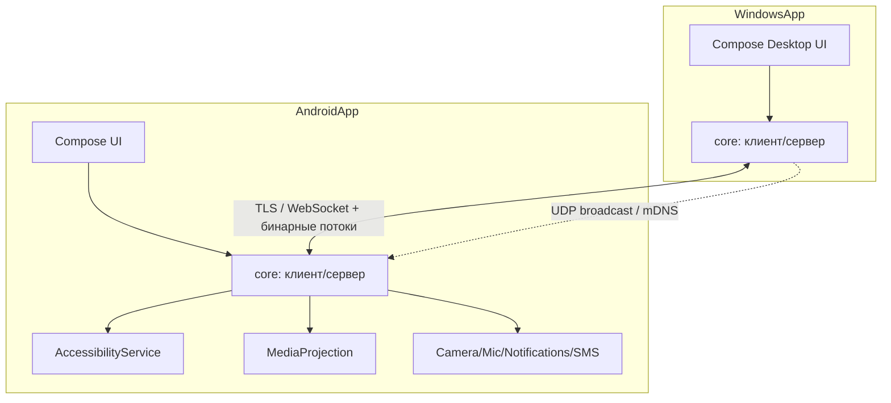

# Эфир — аналог AirDroid (Android ↔ Windows, локальная сеть)

## 1. Цель проекта

Создать пару приложений **Android + Windows**, работающих **в одной локальной сети без интернета**, которые дают:

- удалённое управление экраном Android с ПК (просмотр + инъекция ввода);
- двусторонний файловый менеджер;
- гибкую двустороннюю синхронизацию папок;
- общий буфер обмена и зеркалирование уведомлений;
- трансляцию камеры/микрофона/звука телефона на ПК;
- доступ к SMS и звонкам с ПК.

Рабочее название: **Эфир**.

## 2. Ключевые технические решения (утверждены)

| Область | Решение |
| --- | --- |
| Язык / стек | **Kotlin Multiplatform (KMP) + Compose Multiplatform** |
| Android-приложение | Kotlin + Jetpack Compose, minSdk 26 (Android 8.0) |
| Windows-приложение | Kotlin + Compose Desktop (JVM) |
| Общий код | модуль `core` (KMP): сеть, протокол, discovery, движок синхронизации |
| Управление Android | **без root**: `AccessibilityService` (инъекция ввода) + `MediaProjection` (захват экрана) |
| Обнаружение | mDNS/UDP-бродкаст в LAN |
| Сопряжение | QR-код + PIN |
| Шифрование | TLS (самоподписанные сертификаты, доверие после сопряжения) |
| Транспорт | WebSocket + бинарные потоки для медиа/файлов |

## 3. Архитектура



### Модули репозитория

```
Efir/
  core/            # KMP: протокол, сеть, discovery, sync-engine, crypto
  androidApp/      # Android приложение
  desktopApp/      # Windows приложение (Compose Desktop)
  plans/           # планы и документация
```

## 4. Функциональность по блокам

### 4.1 Подключение и сопряжение

- Авто-обнаружение устройств в LAN (mDNS + UDP-бродкаст).
- Список найденных устройств на обеих сторонах.
- Сопряжение по QR-коду (телефон показывает QR, ПК сканирует — или наоборот) + подтверждение PIN.
- Хранение доверенных устройств (повторное подключение без QR).
- TLS-шифрование канала; сертификаты привязаны к сопряжению.
- Ручное подключение по IP:порт как резерв.
- Индикация статуса: оффлайн / обнаружено / подключено / управляется.

### 4.2 Удалённое управление Android (без root)

- Захват экрана через `MediaProjection` (H.264/VP8 через WebRTC или MJPEG-поток).
- Инъекция нажатий/свайпов/мультитача через `AccessibilityService` (`dispatchGesture`).
- Ввод текста, клавиши Back/Home/Recents, поворот экрана.
- Масштабирование и качество потока (битрейт/разрешение/кадры) — настройка.
- Поддержка нескольких мониторов/ориентаций.
- Управление файлами и запуск приложений с ПК.
- **Ограничение (честно):** без root некоторые системные экраны и защищённый контент (DRM) недоступны.

### 4.3 Файловый менеджер (двусторонний)

- Дерево файлов телефона с ПК и наоборот.
- Загрузка/выгрузка файлов и папок, переименование, удаление, создание папок.
- Догрузка больших файлов с продолжением (resume), чанки, проверка целостности (SHA-256).
- Предпросмотр изображений/видео/документов.
- Множественный выбор и очередь передач с прогрессом.

### 4.4 Синхронизация папок (максимальная гибкость)

- Двусторонняя синхронизация выбранных пар папок (ПК ↔ телефон).
- Режимы запуска: **вручную**, **по расписанию** (интервал/время), **автоматически** (при подключении и/или по изменению файлов в реальном времени).
- Выбор папок и правил включения/исключения (по маске, размеру, типу).
- Стратегии разрешения конфликтов:
  - **слияние** (объединение содержимого);
  - **замещение** (перезапись более новой/выбранной стороны);
  - **добавление** (не удалять, только добавлять новое);
  - **приоритет стороны** (ПК → телефон, телефон → ПК, «самый новый»);
  - **автопереименование при коллизиях** (файл (1), файл (2) …).
- Журнал синхронизации, история версий/бэкап перезаписанных файлов.
- Разрешение конфликтов вручную через UI при необходимости.
- Игнорирование временных файлов, работа с частично загруженными.

### 4.5 Общий буфер обмена

- Копирование текста на ПК → доступно на телефоне и наоборот (с учётом ограничений Android 10+ на фоновый доступ к буферу).
- История буфера.

### 4.6 Уведомления

- Зеркалирование уведомлений Android на ПК (`NotificationListenerService`).
- Отображение, очистка, быстрые действия (где возможно).

### 4.7 Камера / звук

- Трансляция камеры телефона на ПК (режим веб-камеры).
- Передача микрофона и системного звука телефона на ПК (через `AudioPlaybackCapture`, где разрешено).

### 4.8 SMS и звонки

- Просмотр и отправка SMS с ПК (требуется роль SMS-приложения или соответствующие разрешения).
- Приём/отклонение входящих звонков, индикация и ответ через ПК (по возможности).

## 5. Сетевой протокол (черновик)

- **Discovery:** UDP broadcast на порт `X` + mDNS-сервис `_efir._tcp`.
- **Control-канал:** WebSocket поверх TLS, сообщения в формате protobuf/JSON (команды, события, состояние).
- **Media-каналы:** отдельные бинарные потоки (screen, camera, audio) поверх TLS/TCP или WebRTC.
- **File-transfer канал:** чанкованные передачи с resume и хеш-проверкой.
- Версионирование протокола и handshake с обменом возможностями (capabilities).

## 6. Безопасность

- TLS с самоподписанными сертификатами; доверие устанавливается при сопряжении (TOFU + PIN).
- Все соединения только в LAN; никаких внешних серверов.
- Возможность отзыва доверия для устройства.
- Разграничение разрешений на уровне протокола (что разрешено доверенному устройству).

## 7. Ограничения и риски

- **Android-ограничения:** фоновый доступ к буферу обмена, доступ к SMS/звонкам, захват защищённого контента, агрессивные политики батареи.
- **Производительность:** задержка захвата/кодирования экрана и ввода; требуется оптимизация (аппаратное кодирование).
- **Google Play:** использование `AccessibilityService` и `MediaProjection` требует обоснования; для личного использования — sideload.
- **Разные версии Android** (8–15) — необходимо тестирование на спектре.

## 8. Этапы (высокоуровнево)

1. **Каркас:** структура KMP-проекта, сборка Android и Desktop, общий модуль `core`.
2. **Сеть и сопряжение:** discovery, TLS, WebSocket, QR+PIN, список устройств.
3. **Управление экраном:** MediaProjection + AccessibilityService, поток и инъекция ввода.
4. **Файловый менеджер:** навигация, передача с resume/хешем.
5. **Синхронизация:** движок, стратегии, расписания, журнал, UI настроек.
6. **Буфер обмена и уведомления.**
7. **Камера/звук.**
8. **SMS/звонки.**
9. **Полировка:** производительность, стабильность, упаковка/инсталляторы, документация.

## 9. Открытые вопросы (уточняем по ходу)

- Минимальные версии Android и Windows для поддержки.
- Нужна ли поддержка нескольких одновременно подключённых устройств.
- Нужна ли автозагрузка Windows-приложения и фоновый сервис на Android.
- Языки интерфейса (пока русский, мультиязычность позже).
